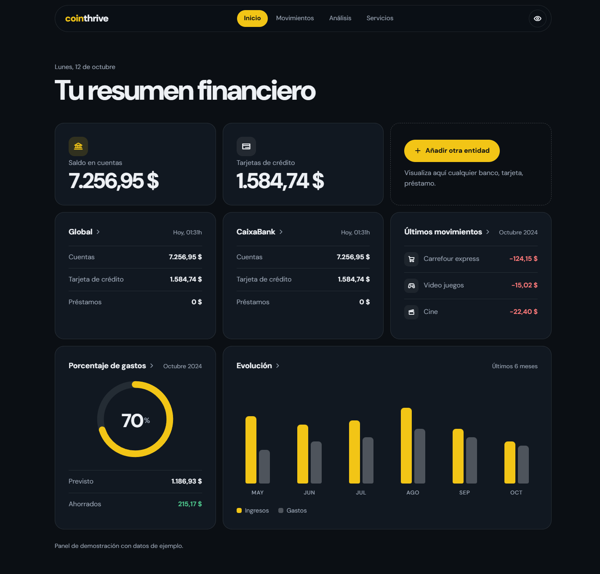

# Cointhrive: panel financiero

Panel de **finanzas personales** que reúne en una sola pantalla los saldos de las cuentas, las tarjetas, los últimos movimientos, el porcentaje del presupuesto gastado y la evolución de ingresos y gastos de los últimos seis meses.

Es la parte "aplicación" del proyecto Cointhrive. La web de presentación y planes está en [Cointhrive-Mobile](https://github.com/Figueira205/Cointhrive-Mobile).

**Demo:** https://figueira205.github.io/Cointhrive/



> Todos los datos son de demostración. No hay conexión con bancos reales.

## Qué muestra cada bloque

| Bloque | Qué hace |
|---|---|
| **Saldo en cuentas y Tarjetas de crédito** | Las dos cifras principales, con animación de recuento al aparecer |
| **Añadir otra entidad** | Punto de entrada para sumar un banco, tarjeta o préstamo |
| **Global y entidad (CaixaBank)** | Desglose de cuentas, tarjeta de crédito y préstamos, con la hora de actualización |
| **Últimos movimientos** | Los gastos más recientes del mes, con icono por categoría |
| **Porcentaje de gastos** | Anillo con el porcentaje gastado, el importe previsto y lo ahorrado |
| **Evolución** | Barras de ingresos frente a gastos de los últimos seis meses; al pasar el cursor se resalta el mes |

## Detalles de la interfaz

- **Ocultar saldos.** El botón del ojo desenfoca todas las cifras para consultar el panel en público. La elección se recuerda en el navegador.
- **Menú con seguimiento.** La pestaña activa cambia según la sección que estás viendo.
- **Fecha y hora reales.** El saludo y la hora de actualización de cada entidad usan la hora del dispositivo.
- **Accesibilidad.** Contraste cuidado, foco visible, etiquetas para lector de pantalla y respeto a la preferencia de movimiento reducido.
- **Adaptable.** Cuadrícula de tres columnas en escritorio, dos en tableta y una en móvil.

## Estructura del proyecto

| Archivo | Función |
|---|---|
| `index.html` | Estructura y contenido del panel |
| `styles.css` | Sistema de diseño: variables, tarjetas, anillo, gráfico y adaptación a pantallas |
| `app.js` | Recuento de cifras, formato en español, menú activo, ocultar saldos y revelado de tarjetas |
| `favicon.ico` | Icono de la pestaña |

## Tecnología

- HTML, CSS y JavaScript sin framework ni compilación.
- Tipografía DM Sans (Google Fonts) e iconos [Phosphor](https://phosphoricons.com/).
- El anillo es un SVG con `stroke-dashoffset` y el gráfico son barras CSS, sin librerías de gráficos.

## Ejecutar en local

```bash
git clone https://github.com/Figueira205/Cointhrive.git
cd Cointhrive
python -m http.server 8000
```

Abre http://localhost:8000.

## Siguientes pasos posibles

- Conectar con una API bancaria agregadora para sustituir los datos de ejemplo.
- Guardar las entidades que añada el usuario.
- Filtros por mes y por categoría en los movimientos.
